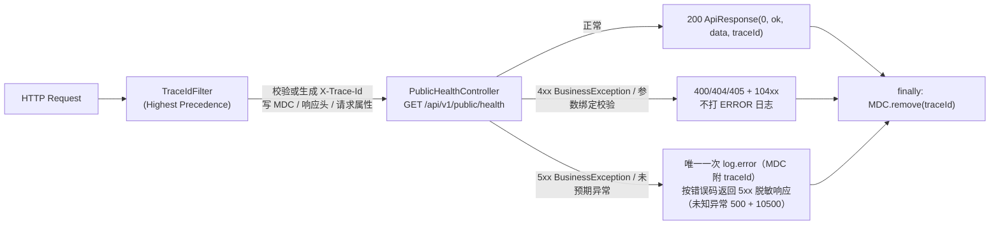

# Landfall（见屿）当前代码树架构

> 本文档严格描述**当前分支磁盘上已落地**的代码结构与运行链路；快速启动与目录入口见 [README.md](../README.md)，尚未落盘的业务模块与前端工作区规划见 [docs/specs/design-proposal.md](./specs/design-proposal.md)。

## 后端包结构与依赖方向

后端源码位于 `backend/src/main/java/com/landfall/`（Java 21 + Spring Boot 3.4.5），当前落盘 `LandfallApplication`、跨模块公共底座 `common` 以及 `module.auth.internal` RBAC 持久化基线：

```text
com.landfall
├── LandfallApplication          # @SpringBootApplication + @ConfigurationPropertiesScan
├── common
│   ├── api                      # ApiResponse<T>、ErrorCode、BusinessException、PaginationProperties、PageQuery、PageResult<T>
│   ├── exception                # GlobalExceptionHandler（@RestControllerAdvice）
│   ├── trace                    # TraceIdContext（公开入口）与 TraceIdFilter（package-private）
│   ├── id                       # UuidV7Generator（薄封装 uuid-creator 的 RFC 9562 单调 UUIDv7）
│   ├── persistence              # PersistenceConfig（@MapperScan）、PostgresUuidTypeHandler、UuidV7IdAssignInterceptor
│   ├── activity                 # ActivityLogRecorder、ActivityAction（公开）与包私有 ActivityLogEntity/Mapper
│   ├── openapi                  # OpenApiConfig（OpenAPI 3 元信息）
│   └── web                      # PublicHealthController（GET /api/v1/public/health）与 HealthResp
└── module
    └── auth
        └── internal             # 5 张 RBAC 表的持久化 Entity、UserStatus 与 BaseMapper（ArchUnit 隔离）
```

单向依赖关系：`common.exception -> common.api -> common.trace`、`common.web -> common.api`、`common.persistence -> common.id`、`common.activity -> common.id`；`common.openapi` 无内部横向依赖。

## 持久化、迁移与缓存基线

- **数据源与 Flyway 迁移**：接入 PostgreSQL 16 + MyBatis-Plus（禁全局 `@TableLogic`，`id-type: input`）+ Flyway 正向迁移。首版脚本 `backend/src/main/resources/db/migration/V001__auth_init_rbac.sql` 建立 `sys_user`、`sys_role`、`sys_permission`、`sys_user_role`、`sys_role_permission` 与 `user_activity_logs` 6 张表，预置 3 个内置角色（`ROLE_USER`、`ROLE_MODERATOR`、`ROLE_ADMIN`）及以 `admin:access` 为根的两级 9 权限点种子树；`sys_user` 对 `LOWER(username)` 与 `LOWER(email)` 建 `WHERE deleted_at IS NULL` 大小写不敏感部分唯一索引。
- **主键与类型映射**：`PostgresUuidTypeHandler` 全局处理 PostgreSQL 原生 `UUID`；`UuidV7IdAssignInterceptor` 在 `INSERT` 时为未赋值的 `UUID` `@TableId` 自动填充单调 UUIDv7（保留显式传入的主键）。
- **Redis 7 接入**：配置 `spring.data.redis.*` 连接与 3s 读写/连接超时上限，供后续 `OpaqueToken` 会话与权限缓存使用。

## 请求追踪与异常处理链路



- **配置加载**：`backend/src/main/resources/application.yml` 通过 `spring.config.import` 可选读取根目录 `.env`（支持 `POSTGRES_*`、`REDIS_*` 与 `SERVER_PORT` 覆盖）。
- **分页与错误码契约**：分页归一化（`PaginationProperties` → `PageQuery` → `PageResult`）与 5 位百位子域错误码表以 [docs/standards/api-contract.md](./standards/api-contract.md) 为唯一权威定义；当前 `ErrorCode` 仅登记已有真实映射方的 `10400`、`10404`、`10405`、`10500`。

## 自动化架构与质量门禁

- **ArchUnit**（`backend/src/test/java/com/landfall/architecture/ModuleArchitectureTest.java`）：校验 `com.landfall.module.(*)..` 跨模块与非模块禁止访问 `..internal..`（附测试夹具自证拦截生效）、业务模块与 `common` 子包无循环依赖、Controller 不依赖本仓 `*Mapper`/`*Entity`/`@TableName`、禁止字段注入及生产类非空扫描守卫。
- **双轨门禁串联**：
  - 快速门禁（免容器）：`Makefile` 暴露 `make check-docs`、`make check-migrations`（`scripts/check-migrations.py` 拦截对 `origin/dev` 历史 `V*.sql` 的改/删）、`make backend-style-check` 与 `make backend-verify`（`*Test.java`、ArchUnit、打包、Spotless、Checkstyle），供本地、`.pre-commit-config.yaml` 与 `.github/workflows/ci.yml` 的 `verify` 任务复用；
  - 真库集成门禁：`make backend-it`（`*IT.java`，由 `AbstractIntegrationTest` 动态建删临时 PostgreSQL 16 库并隔离 Redis DB `15`），供本地 `make up` 后与 CI 的 `integration-test` 任务（挂载 `postgres:16-alpine` + `redis:7-alpine` 服务容器）执行。
