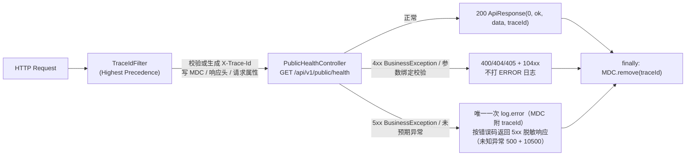

# Landfall（见屿）当前代码树架构

> 本文档严格描述**当前分支磁盘上已落地**的代码结构与运行链路；快速启动与目录入口见 [README.md](../README.md)，尚未落盘的业务模块与前端工作区规划见 [docs/specs/design-proposal.md](./specs/design-proposal.md)。

## 后端包结构与依赖方向

后端源码位于 `backend/src/main/java/com/landfall/`（Java 21 + Spring Boot 3.4.5），当前落盘 `LandfallApplication` 与跨模块公共底座 `common`：

```text
com.landfall
├── LandfallApplication          # @SpringBootApplication + @ConfigurationPropertiesScan
└── common
    ├── api                      # ApiResponse<T>、ErrorCode、BusinessException、PaginationProperties、PageQuery、PageResult<T>
    ├── exception                # GlobalExceptionHandler（@RestControllerAdvice）
    ├── trace                    # TraceIdContext（公开入口）与 TraceIdFilter（package-private）
    ├── id                       # UuidV7Generator（薄封装 uuid-creator 的 RFC 9562 单调 UUIDv7）
    ├── openapi                  # OpenApiConfig（OpenAPI 3 元信息）
    └── web                      # PublicHealthController（GET /api/v1/public/health）与 HealthResp
```

单向依赖关系：`common.exception -> common.api -> common.trace`、`common.web -> common.api`；`common.id` 与 `common.openapi` 无内部横向依赖。

## 请求追踪与异常处理链路



- **配置加载**：`backend/src/main/resources/application.yml` 通过 `spring.config.import` 可选读取根目录 `.env`（支持 `SERVER_PORT` 等覆盖）。
- **分页与错误码契约**：分页归一化（`PaginationProperties` → `PageQuery` → `PageResult`）与 5 位百位子域错误码表以 [docs/standards/api-contract.md](./standards/api-contract.md) 为唯一权威定义；当前 `ErrorCode` 仅登记已有真实映射方的 `10400`、`10404`、`10405`、`10500`。

## 自动化架构与质量门禁

- **ArchUnit**（`backend/src/test/java/com/landfall/architecture/ModuleArchitectureTest.java`）：校验 `com.landfall.module.(*)..` 跨模块与非模块禁止访问 `..internal..`（附测试夹具自证拦截生效）、业务模块与 `common` 子包无循环依赖、Controller 不依赖本仓 `*Mapper`/`*Entity`/`@TableName`、禁止字段注入及生产类非空扫描守卫。
- **门禁串联**：`Makefile` 统一暴露 `make check-docs`、`make backend-style-check` 与 `make backend-verify`，供本地开发、`.pre-commit-config.yaml`（含 `pre-commit-hooks` 与 `Yelp/detect-secrets`）与 `.github/workflows/ci.yml`（含 `gitleaks-action@v2`）复用。
