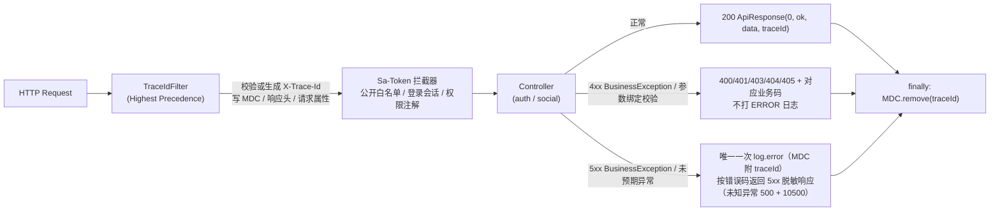
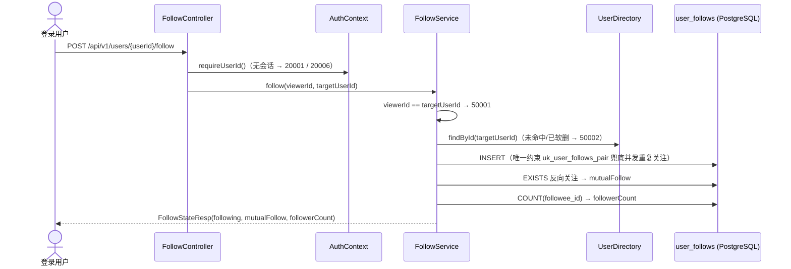

# Landfall（见屿）当前代码树架构

> 本文档严格描述**当前分支磁盘上已落地**的代码结构与运行链路；快速启动与目录入口见 [README.md](../README.md)，尚未落盘的业务模块与前端工作区规划见 [docs/specs/design-proposal.md](./specs/design-proposal.md)。

## 后端包结构与依赖方向

后端源码位于 `backend/src/main/java/com/landfall/`（Java 21 + Spring Boot 3.4.5），当前落盘 `LandfallApplication`、跨模块公共底座 `common`，以及 `auth`、`social` 两个业务模块与 `storage` 基础模块：

```text
com.landfall
├── LandfallApplication          # @SpringBootApplication + @ConfigurationPropertiesScan
├── common
│   ├── activity                 # ActivityLog 记录器与实体（登录等活跃行为流水）
│   ├── api                      # ApiResponse<T>、ErrorCode、BusinessException、PaginationProperties、PageQuery、PageResult<T>
│   ├── exception                # GlobalExceptionHandler（@RestControllerAdvice）
│   ├── id                       # UuidV7Generator（薄封装 uuid-creator 的 RFC 9562 单调 UUIDv7）
│   ├── openapi                  # OpenApiConfig（OpenAPI 3 元信息）
│   ├── persistence              # PersistenceConfig、UUIDv7 主键兜底拦截器、PostgreSQL UUID 类型处理器
│   ├── trace                    # TraceIdContext（公开入口）与 TraceIdFilter（package-private）
│   └── web                      # PublicHealthController（GET /api/v1/public/health）与 HealthResp
├── module
│   ├── auth                     # 跨模块公开面：AuthContext、AuthenticatedUser、UserDirectory、UserSummary
│   │   └── internal             # 注册/登录/OpaqueToken 会话/RBAC 实现与 sys_* 持久化映射
│   └── social                   # 关注关系与主页（当前落盘关注/取关写入链路）
│       └── internal             # FollowController、FollowService、UserFollowMapper、UserFollowEntity
└── storage                      # StorageAdapter 抽象与 LocalDiskStorageAdapter 实现
```

单向依赖关系：`common.exception -> common.api -> common.trace`、`common.web -> common.api`；`common.id`、`common.persistence` 与 `common.openapi` 无内部横向依赖。业务模块通过 `AuthContext`（当前用户）与 `UserDirectory`（按 id 批量读取用户展示信息）访问身份数据，**不得直接依赖 `sys_user` 表或 auth 的 `.internal` 包**。

## 请求追踪与异常处理链路



- **配置加载**：`backend/src/main/resources/application.yml` 通过 `spring.config.import` 可选读取根目录 `.env`（支持 `SERVER_PORT` 等覆盖）。
- **分页与错误码契约**：分页归一化（`PaginationProperties` → `PageQuery` → `PageResult`）与 5 位百位子域错误码表以 [docs/standards/api-contract.md](./standards/api-contract.md) 为唯一权威定义。

## 关注关系写入链路（social）



- 表结构见迁移 [V002__social_init_follows.sql](../backend/src/main/resources/db/migration/V002__social_init_follows.sql)：单向 `Follow` 记录，**不设 `is_mutual` 冗余列**，双向记录同时存在才构成 `MutualFollow`（见 [GLOSSARY.md](../GLOSSARY.md)）。
- 关注/取关均为幂等写：唯一约束拦截重复关注，DELETE 对不存在的关系同样返回成功状态。

## 自动化架构与质量门禁

- **ArchUnit**（`backend/src/test/java/com/landfall/architecture/ModuleArchitectureTest.java`）：校验 `com.landfall.module.(*)..` 跨模块与非模块禁止访问 `..internal..`（附测试夹具自证拦截生效）、业务模块与 `common` 子包无循环依赖、Controller 不依赖本仓 `*Mapper`/`*Entity`/`@TableName`、禁止字段注入及生产类非空扫描守卫。
- **门禁串联**：`Makefile` 统一暴露 `make check-docs`、`make backend-style-check`、`make backend-verify` 与 `make backend-it`，供本地开发、`.pre-commit-config.yaml` 与 `.github/workflows/ci.yml` 复用；集成测试（`*IT`）连接真实 PostgreSQL 16 + Redis 7，严禁 H2 替代。
